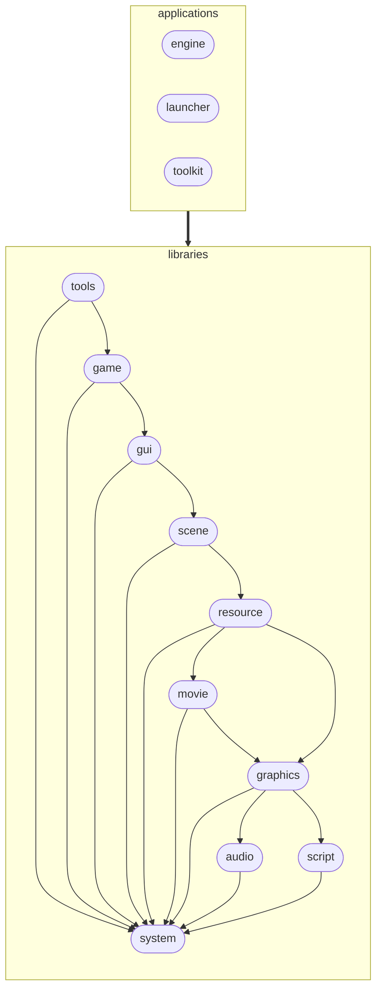
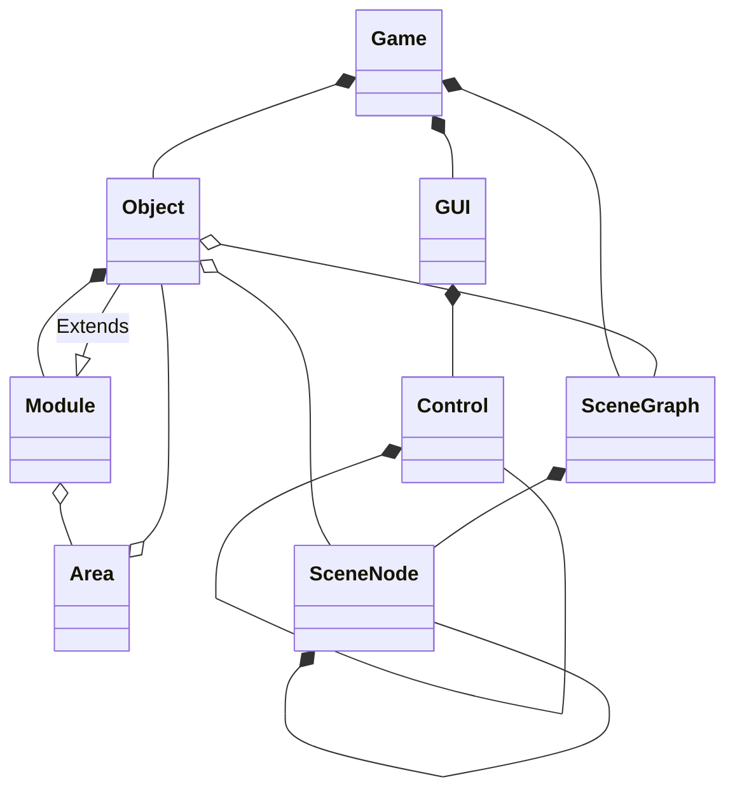

# Project Architecture

## Modules

Source code is organized into modules, each module containing a different engine subsystem. Dependency must be from higher- to lower-level modules (top to bottom in the diagram). Circular dependencies must be avoided.

### Applications

- _engine_ is the engine executable
- _launcher_ is a GUI application to configure and launch the engine
- _toolkit_ is a GUI application to inspect game resources and invoke [tools](tooling.md)
- _dataminer_ extracts information from game resources
- _gff2json_ converts GFF resources to JSON
- _unerf_ extracts ERF archives
- _ncsrun_ executes NCS programs without a game context
- _shaderpack_ packs GLSL shaders into an ERF archive during the build

### Libraries

- _tools_ contains tools implementations and supporting code
- _game_ contains the game logic
- _gui_ contains the GUI subsystem
- _scene_ contains the scene management subsystem
- _resource_ contains the resource management subsystem
- _json_ contains JSON serialization of game resources
- _movie_ contains the movie playback subsystem
- _script_ contains the scripting subsystem
- _graphics_ contains the graphics subsystem
- _audio_ contains the audio subsystem
- _input_ contains the input event types and key codes
- _system_ contains common utility classes and functions

## Object Hierarchies

## File and Class Names

_types.h_ files contain enums, constants and aliases that do not belong to a particular class.

_*util.(h|cpp)_ files contain utility functions.

File format handling is encapsulated in `*Reader` and `*Writer` classes. These classes are grouped into _format_ folders.

Plurals denote classes that provide a certain type of objects, e.g. `Resources` and `Models`.

## Dependency Injection

Services are abstracted pieces of logic. Each module initializes it's own services in a `*Module` class. `*Module` class provides `*Services` structure with service references that can be injected into higher-level modules.

## Memory Model

Prefer allocating memory on initialization or on demand to allocating it every frame.

Prefer stack allocation to dynamic allocation, unless the object is large or variable is late-initialized. Use smart pointers for dynamic allocation.

## Threads

Engine is predominantly single-threaded at the moment. Desired state however is the following:

- Rendering and audio playback should happen on the main thread
- Game updates should happen on a dedicated thread
- IO and arbitrary computations should be executed by a thread pool
